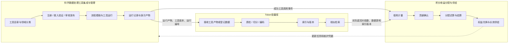

# AI-Ready 科学数据服务平台演示系统

面向海洋科学、天文科学和生命科学的数据处理与服务场景，演示科学数据处理工具集成、张量/向量数据管理、使用计量、贡献确认、积分收益分配和长效供给之间的业务关系。当前版本是浏览器本地演示，不连接真实工具服务、共享数据库或生产结算系统。

## 总体架构



三个工作空间通过首页导航和同源浏览器事件日志联动。它们保留各自的业务数据；桥接事件把运行产物、成功调用、数据版本和检索用量关联起来，收益模块据此生成待核验流水。

## 模块职责

### 科学数据处理工具集成与管理

入口位于 `#/tools/catalog`，按海洋科学、天文科学、生命科学三个领域管理工具。

- **工具目录**：按领域、能力、接入形式和状态检索工具，查看工具编号、版本、提供方及运行状态。
- **注册与接入**：登记输入输出契约、运行依赖、许可证、代码/服务地址和样例；工具依次经过接入验证、审核和发布。
- **工具链配置**：选择同一领域的已发布工具，保存和发布流程模板，按节点顺序试运行。
- **评价与运维**：查看运行编号、输入引用、工具版本、质量结果、失败原因及演示产物。
- **工具共建**：审核科研参与方提交的工具、版本变化、许可证和验证材料，保留通过或退回结果。

当前运行由本地演示逻辑生成，不会执行登记的外部代码、调用 MCP 地址或连接真实服务。成功运行会生成明确标注的演示报告；失败运行只留下失败记录，不形成计量事件。

### Token张量库

入口为首页“Token张量库”，独立页面为 `vector.html`。张量库保留原有九页能力：数据接入、分片与质检、特征编码、索引浏览、索引版本、运行记录、相似检索和检索评测等。

工具工作台的演示产物会出现在“数据接入”的待接收区。登记后，它作为待编码数据源进入已有质检、编码、索引发布流程；来源信息保留工具运行编号、输入引用和工具版本。演示报告不是实际科学数据处理结果。

### 积分收益分配与长效供给

入口位于 `#/value/overview`，主要页面包括收益与供给总览、使用与计量、贡献确认、分配试算、结算台账、权益兑换、长效供给和业务追溯。

成功的工具运行和有实际返回结果的向量检索会生成待计量事件。事件导入后创建使用流水和待核验贡献凭据；只有人工确认的贡献进入分配试算。确认结算后形成不可变批次快照，供给留存进入任务预算。供给任务验收沿用现有运营逻辑，当前不会自动修改张量库中的原始数据。

## 闭环演示

1. 在工具目录中选择“正常样例”，试运行任一已发布工具。运行记录出现产物编号，工具侧成功调用进入待计量队列。
2. 打开Token张量库的数据接入页，在“来自工具工作台的产物”登记报告。报告会标注工具版本、运行编号和输入引用。
3. 对新数据源质检或沿用片段，执行编码并发布索引版本，再执行检索。只有实际返回的片段才形成数据侧用量事件。
4. 回到积分收益分配与供给的“使用与计量”，查看跨模块来源、凭据和版本；在“贡献确认”核对主体和证据后确认或排除。
5. 已确认贡献可以进入分配试算、结算台账和后续权益/供给流程。

## 事件与计量口径

桥接事件由 `portal/integration.js` 管理，最多保留最近 600 条。事件包含唯一编号、类型、时间、状态和业务载荷；收益模块按事件编号去重，并在刷新或同站点其他标签页产生事件后补同步。

当前演示费率是数据侧每返回片段 2 积分、工具侧每成功节点 18 积分。积分在此仅是演示服务权益单位，不代表实际收费或货币。不同来源的主体按三个领域的演示映射预填，映射不代表真实权属或贡献认定；核验人员仍需检查主体、来源、版本、质量证据和重复情况。

结算计算由收益模块原有规则完成：三侧贡献权重示例为 45% / 30% / 25%，运营成本和供给留存示例分别为收入的 10% 和 15%。它们是可调整的演示参数，正式规则须由项目确认。

## 存储与边界

- 工具目录、收益运营、张量库分别使用独立的浏览器本地存储；桥接事件使用单独的事件日志。它们不会因共享事件而合并为一个数据库。
- 联动要求同一浏览器、同一站点来源，例如相同的 GitHub Pages 地址或相同本地 HTTP 地址。不同浏览器、不同端口或 `file:` 打开时不会共享联动事件。
- 收益演示起点恢复只重置收益运营样例，并记录已有桥接事件编号以防旧事件重新计量；工具目录和张量库保持各自数据。
- 同源事件只用于本地演示。生产化还需共享后端、用户与服务身份、鉴权和授权、持久化事件/任务服务、审计策略、真实工具执行环境、正式价格和权益规则，以及跨系统失败恢复机制。

## 项目结构

| 路径 | 职责 |
| --- | --- |
| `index.html` | 平台首页、工作区容器、收益页面模板和模块装配 |
| `portal/navigation.js` | 首页模块、工具和收益页面导航定义 |
| `portal/tools.js` | 工具目录、接入审核、流程模板、运行记录与社区审核 |
| `portal/integration.js` | 三模块之间的同源事件日志、去重和跨标签页通知 |
| `portal/platform.js` | 平台路由、收益工作区、事件同步、凭据核验和结算交互 |
| `portal/operations.js` | 计量、贡献、收益分配、结算和供给任务业务规则 |
| `vector.html` | Token张量库九页工作台页面 |
| `js/app.js` | 张量库接入、质检/编码流程入口、索引检索及事件发布 |
| `js/model.js`, `js/engineering.js`, `js/engineering-ui.js` | 数据解析、编码、质检、索引版本、检索评测和运行记录 |
| `scripts/verify-operations.cjs` | 收益分配、结算、兑换和供给业务验证 |
| `scripts/verify-integration.cjs` | 三模块事件联动和端到端业务闭环验证 |

## 运行与验证

推荐使用桌面版 Chrome 或 Edge。可直接打开根目录 `index.html`；若浏览器限制本地存储，使用 Python 启动同源 HTTP 服务：

```powershell
python -m http.server 8000
```

然后访问 `http://localhost:8000/`。联动测试需要保持相同协议、主机和端口。

运行验证脚本：

```powershell
node scripts/verify-operations.cjs
node scripts/verify-integration.cjs
```

## GitHub Pages

仓库包含 `.github/workflows/pages.yml`。首次发布时，在 GitHub 仓库 **Settings → Pages → Build and deployment → Source** 选择 **GitHub Actions**。之后推送到 `main` 会自动部署，也可以在 **Actions** 页面手动运行部署工作流。站点地址为 <https://che618.github.io/Vector/>。
